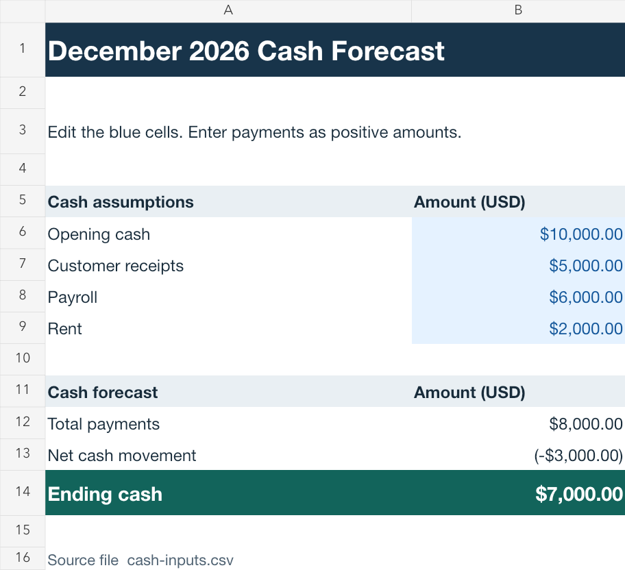
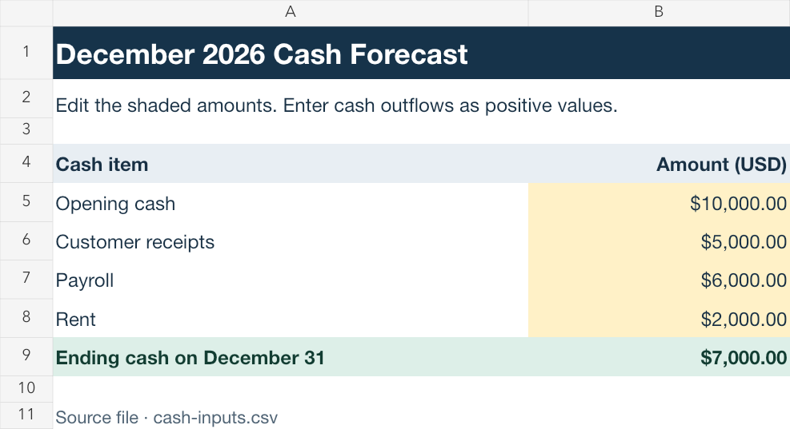

# Good Enough

**Ponytail for knowledge worker**

Good Enough is an agent skill for making documents, spreadsheets, financial models, and presentations that are complete, correct, and easy to use. Every section, tab, slide, and visual should help the reader do something.

[See the cash forecast benchmark](#cash-forecast-benchmark) for an example with downloadable workbooks.

| If you need a… | Good Enough helps the agent… |
| --- | --- |
| Decision brief | State the decision, the recommendation when supported, and the trade-offs that affect the choice. |
| Impact analysis | Show what changes in each affected case, who is affected, and what still needs a decision. |
| Standard operating procedure (SOP) | Write steps a new operator can follow, with common exceptions and a clear check for completion. |
| Tracker | Use a clear table and readable formulas. Add a dashboard when it serves a distinct task. |
| Financial model | Label the assumptions and show how they drive the results a human needs to understand. |
| Slide deck | Give each slide one main takeaway and keep the evidence that supports it. |

## Install

### Ask your agent to install

Copy this prompt into your agent's chat.

```text
Install the good-enough skill from https://github.com/bagusfarisa/good-enough.
The skill folder is skills/good-enough on main.

Identify the agent harness you're running in. Use its documented skill installer
or skills directory and perform the installation yourself. Use the current project
if there is one, or install it for my user account otherwise. If Good Enough is
already installed from this repository, update that installation.

Verify the installation and tell me how to invoke the skill. If I need to reload
or start a new session, tell me.
```

### Installer commands

From your project, run the [Skills CLI](https://github.com/vercel-labs/skills) (Node.js 22.20+) and select your agents when prompted. Add `-g` to install for your user account.

```sh
npx skills add bagusfarisa/good-enough --skill good-enough
```

In [Codex](https://learn.chatgpt.com/docs/build-skills#install-curated-skills-for-local-use), you can also paste this into a chat:

```text
$skill-installer https://github.com/bagusfarisa/good-enough/tree/main/skills/good-enough
```

In [Pi](https://github.com/earendil-works/pi/blob/main/packages/coding-agent/docs/packages.md), you can install directly from Git. Add `--local` for the current project.

```sh
pi install git:github.com/bagusfarisa/good-enough
```

### Install manually

Copy the [`good-enough` folder](skills/good-enough) into one of the locations below. For example, a project install in Claude Code should end up at `.claude/skills/good-enough/SKILL.md`.

| Agent | Project directory | Personal directory |
| --- | --- | --- |
| [Claude Code](https://code.claude.com/docs/en/skills#choose-where-skills-load) | `.claude/skills/` | `~/.claude/skills/` |
| [Antigravity](https://antigravity.google/docs/skills) | `.agents/skills/` | `~/.gemini/config/skills/` |
| [Pi](https://github.com/earendil-works/pi/blob/main/packages/coding-agent/docs/skills.md#add-it-to-pi) | `.agents/skills/` | `~/.agents/skills/` |
| [OpenCode](https://opencode.ai/docs/skills/#discovery) | `.opencode/skills/` | `~/.config/opencode/skills/` |
| [Codex](https://learn.chatgpt.com/docs/build-skills#where-codex-loads-local-skills) | `.agents/skills/` | `~/.agents/skills/` |
| [Cursor](https://cursor.com/docs/skills#skill-directories) | `.cursor/skills/` | `~/.cursor/skills/` |
| [GitHub Copilot](https://docs.github.com/en/copilot/concepts/customizations/agent-skills#finding-and-storing-skills) | `.github/skills/` | `~/.copilot/skills/` |
| [Gemini CLI](https://geminicli.com/docs/cli/skills/) | `.gemini/skills/` | `~/.gemini/skills/` |

For any other agent that supports the [Agent Skills format](https://agentskills.io/specification), use its documented skills directory and the same [`SKILL.md`](skills/good-enough/SKILL.md).

## Update

Changes to [`skills/good-enough/SKILL.md`](skills/good-enough/SKILL.md) are published on `main`. Refresh your local installation after a change lands.

- **Skills CLI.** Run `npx skills update good-enough --project` from the project, or `npx skills update good-enough --global` for a personal install. If you install for multiple agents, choose the symlink option so they share one local copy. [Skills CLI reference](https://github.com/vercel-labs/skills/blob/main/docs/commands.md#skills-update)
- **Pi Git package.** Run `pi update git:github.com/bagusfarisa/good-enough`, then `/reload` in your Pi session. For a project install, run the update from that project. [Pi package commands](https://github.com/earendil-works/pi/blob/main/packages/coding-agent/docs/cli.md#update-pi-or-packages)
- **Manual or Codex `$skill-installer` install.** Download the latest `SKILL.md` from `main` and replace the file in your existing `good-enough` folder. Open a new agent session if it still shows the previous version.

## Use it

Ask your agent to use the `good-enough` skill. Codex also accepts `$good-enough`, Claude Code and Antigravity offer `/good-enough`, and Pi offers `/skill:good-enough`.

```text
Use the good-enough skill to build a 12-month cash forecast. Make it easy for a reviewer to trace the ending cash balance back to the assumptions.
```

The skill guides how the agent structures and reviews the work. The file formats it can produce depend on its available tools.

## Cash forecast benchmark

Try the same task in both workbooks. Change **Payroll** from **$6,000** to **$7,000** and verify that **Ending cash** changes from **$7,000** to **$6,000**.

| Baseline | With Good Enough |
| --- | --- |
|  |  |
| [Open the baseline workbook](evals/cash-forecast/workbooks/01-baseline.xlsx) | [Open the Good Enough workbook](evals/cash-forecast/workbooks/01-good-enough.xlsx) |

| Result across three pairs | Baseline | With Good Enough |
| --- | ---: | ---: |
| Scripted payroll task completed | 3/3 | 3/3 |
| Workbooks passing all correctness checks | 3/3 | 3/3 |
| Workbook failures | 0 | 0 |
| Median filled rows on the opening sheet | 11 | 9 |

Good Enough used fewer filled rows in all three pairs. In the example above, the baseline shows two intermediate cash totals. Good Enough puts the result directly below its inputs. This pilot measured workbook behavior and layout. Reader completion time remains unmeasured.

Tested with Codex CLI **0.172.0**, model **`gpt-6.2-sol`** at low reasoning effort, and skill commit [`01eb485`](https://github.com/bagusfarisa/good-enough/blob/01eb48510be3bbbcffc88263268865b5448098eb/skills/good-enough/SKILL.md). [Method and all workbooks](evals/cash-forecast/) · [Prompt](evals/cash-forecast/prompt.txt) · [Inputs](evals/cash-forecast/cash-inputs.csv) · [Raw scores](evals/cash-forecast/scores.json)

## Inspiration

Inspired by Dietrich Gebert’s [Ponytail](https://github.com/DietrichGebert/ponytail), which applies the same preference for simple, complete work to coding.
