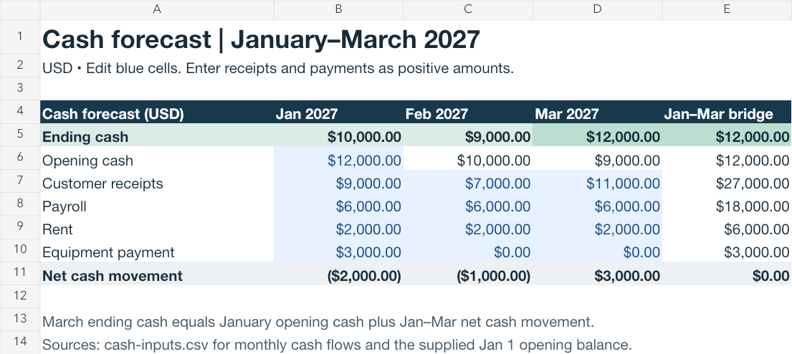
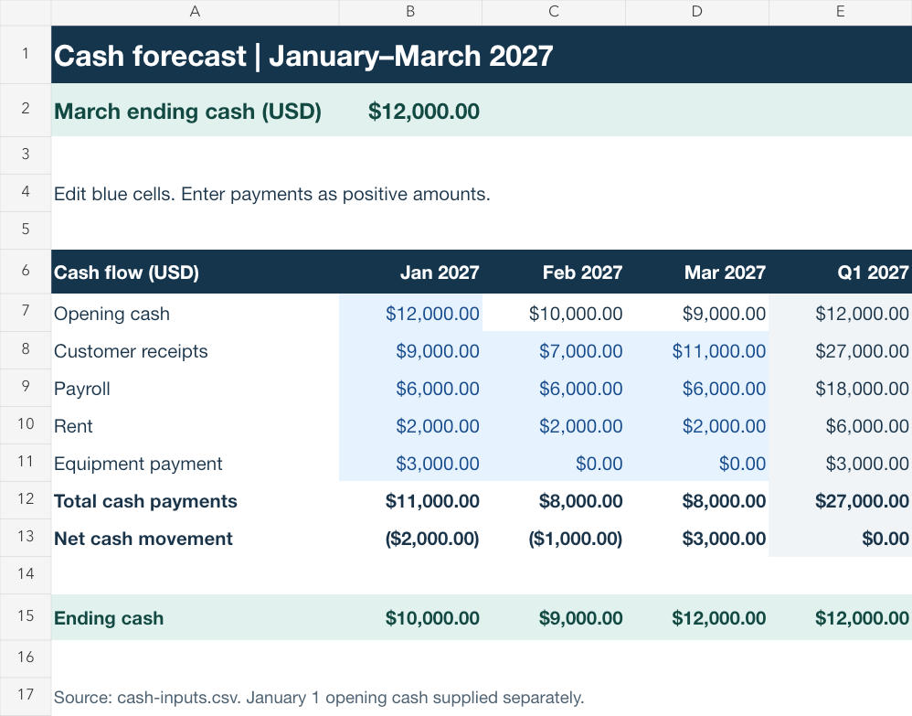

# Three-month financial traceability test

This synthetic forecast tests whether an operations lead can explain the headline result from visible values. January opens at **$12,000**. Ending cash is **$10,000** in January, **$9,000** in February, and **$12,000** in March. The March calculation begins with February's ending cash, adds **$11,000** of receipts, and subtracts **$8,000** of payments. [Task](prompt.txt) · [Monthly inputs](cash-inputs.csv) · [Reader questions and expected answers](reader-questions.json)

| Previous skill | Revised skill |
| --- | --- |
|  |  |
| [Open the previous-skill workbook](workbooks/01-baseline.xlsx) | [Open the revised-skill workbook](workbooks/01-good-enough.xlsx) |

To try the timing check, move **$3,000** of receipts from February to March by setting receipts to **$4,000** and **$14,000** in those months. February ending cash and March opening cash should fall to **$6,000**. March ending cash should still be **$12,000**.

## Results

| Measure | Previous skill | Revised skill |
| --- | ---: | ---: |
| Workbooks passing all calculation checks | 3/3 | 3/3 |
| Workbooks showing the March cash bridge | 3/3 | 3/3 |
| Workbooks showing the March payments subtotal | 1/3 | 3/3 |
| Reader answers correct and supported by visible cells | 9/9 | 9/9 |

Every workbook showed the labeled figures needed to recover March ending cash. The revised skill surfaced the **$8,000** of March payments as a labeled subtotal in every run. The automated reader recovered the same answers from both revisions. [All six workbooks](workbooks/) · [Calculation and layout scores](scores.json) · [Reader answers and citations](reader-scores.json) · [Visible cell values](visible-values.json)

## Method

- **Generation.** Three fresh paired runs compared Good Enough at [previous revision `4fd6856`](https://github.com/bagusfarisa/good-enough/blob/4fd6856add1bc090a01cd4d290ac9663f6420ac4/skills/good-enough/SKILL.md) and [revised revision `f2b31db`](https://github.com/bagusfarisa/good-enough/blob/f2b31db16147a1f1953c2b948b0724040afcf63a/skills/good-enough/SKILL.md). Both used Codex CLI `0.172.0`, `gpt-6.2-sol` at low reasoning effort, identical synthetic inputs, and the same [workbook runtime instructions](../cash-forecast/runtime.txt). All six logs verified that the agent read the supplied skill.
- **Calculation.** Checks compared the input values, monthly closing formulas and saved results, and opening balances against the fixture. Artifact Tool tested the two receipt edits in memory. LibreOffice independently recalculated disposable copies after the same edits, with cached formula results removed. Published workbooks retain the original inputs.
- **Visible calculations.** The checks record whether March opening cash, net cash change, and ending cash are shown and whether February ending cash is visible. A separate check records a labeled **$8,000** March payments subtotal.
- **Reader test.** Fresh `gpt-6.1-terra` sessions saw only the visible worksheet labels and values for one workbook at a time. The test withheld cell formulas, source notes, and the skill revision. The reader answered three questions and identified supporting cells. The script checked answers against the independently calculated values and verified the cited cells. Two responses also included arithmetic in their evidence lists. Only valid cell addresses count toward evidence. This tests what an automated reader can recover from displayed values. Human reading effort remains unmeasured.

## Rerun the reader test

Run from a clone with an authenticated Codex CLI and Python 3.10 or newer.

```sh
python3 evals/financial-traceability/reader.py --out /tmp/good-enough-trace-reader
```
